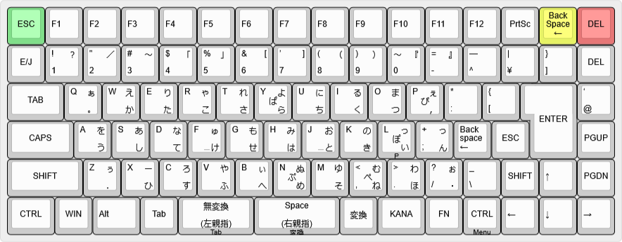
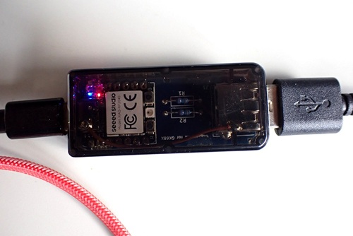
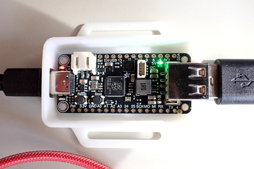

# hoboNicolaキーボードアダプター

本プロジェクトは、Takeshi Higasa 氏によるオリジナルの **hoboNicola keyboard and adapter library**
（Copyright (c) Takeshi Higasa, okiraku-camera.tokyo）
をベースに、いくつかの変更と機能追加を行ったものです。

詳細については、次の記事を参照してください。

- USB付きAdafruit Feather RP2040で作るhoboNicolaアダプター  
  https://note.com/ja7rhk/n/n6bc1aad14891

## 想定しているキーボード

富士通製の親指シフトキーボードは現在では入手が難しくなっていますが、NuPhy Nude75 JIS のようにキーマップを自由に変更できるキーボードを利用することで、親指シフト環境を構築できます。

本プロジェクトでは、キーキャップを入れ替えて OASYS 系列の NICOLA-F レイアウト風にした NuPhy Nude75 JIS を対象として動作確認を行っています。

## Arduinoボード（アダプター用）

以下のRP2040搭載ボードに対応しています。

### Seeed Studio XIAO RP2040

### Adafruit Feather RP2040 USB Host

## ビルド

ビルド環境の構築およびファームウェアのビルド方法については、次の記事を参照してください。

- rp_hobo_nicola のビルド環境  
  https://note.com/ja7rhk/n/nad39d4adbd38